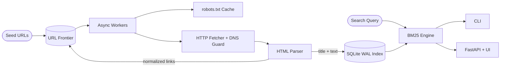
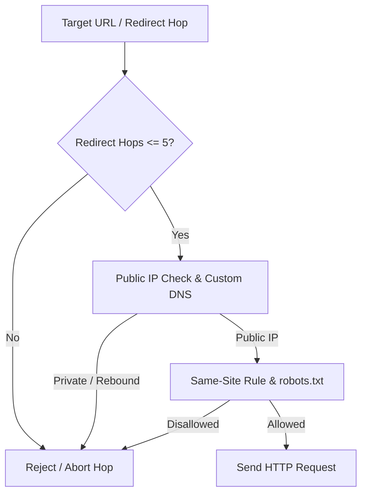

# 🔍 PySearch

An async web crawler and full-text search engine written from scratch in Python. It crawls sites politely, builds a transactional inverted index in SQLite, and ranks results using **Okapi BM25**—accessible via CLI, a FastAPI JSON API, or a lightweight web UI.

---

## Table of Contents

- [Features](#features)
- [Architecture & Data Flow](#architecture--data-flow)
- [Quick Start](#quick-start)
- [API Endpoints](#api-endpoints)
- [Security & SSRF Protection](#security--ssrf-protection)
- [robots.txt Handling (RFC 9309)](#robotstxt-handling-rfc-9309)
- [Ranking & Search Quality](#ranking--search-quality)
- [Docker](#docker)
- [Project Layout](#project-layout)
- [Testing](#testing)
- [Changelog](#changelog)
- [Roadmap](#roadmap)

---

## Features

- **Async crawler** (`asyncio` + `aiohttp`) with a worker pool and breadth-first frontier.
- **Polite by default**: `robots.txt` (`Disallow` and `Crawl-delay`), per-host rate limiting, response size cap, timeouts, and retries with exponential backoff.
- **SSRF protection**: Blocks `localhost`, `.local`, `.internal`, loopback, RFC 1918 private ranges, link-local (`169.254.169.254`), CGNAT, multicast, IPv4-mapped IPv6, numeric IP tricks (`2130706433`, `0x7f.0.0.1`), system proxies (`trust_env=False`), and DNS rebinding.
- **Pre-hop redirect validation**: Every redirect hop is validated (public IP, same-site rule ignoring `www.`, and target `robots.txt`) *before* the request is sent.
- **Strict size & length limits**: Oversized responses are flagged (`too_large`) and skipped rather than indexed half-read; indexed text is capped at 100,000 characters so document length, postings, and stored text stay consistent.
- **Transactional SQLite index (WAL mode)**: Supports exact-duplicate detection, safe re-indexing in a single transaction, and removal of stale entries on `noindex`, `404`, or `410`.
- **BM25 ranking & stemmed snippets**: Scores with title boosting (3x), full-match bonus (1.25x), stopwords, light stemming, and stem-matched highlighted snippets.
- **Offline-ready test suite**: Injectable `Fetcher` plus unit, crawler, and local HTTP server tests (`pytest -q`).
- **Search-quality evaluation**: `pysearch eval` computes `Precision@k`, `Recall@k`, `MRR`, and `NDCG@k`.

---

## Architecture & Data Flow

### Crawl, Index & Query Flow



### Pre-Request Redirect & SSRF Guard



---

## Quick Start

```bash
python -m venv .venv && source .venv/bin/activate
pip install -e ".[dev]"

pysearch crawl [https://docs.python.org/3/tutorial/](https://docs.python.org/3/tutorial/) --max-pages 50 --max-depth 2
pysearch search "list comprehension"
pysearch serve            # [http://127.0.0.1:8000](http://127.0.0.1:8000)
```

> **Note:** Only crawl sites you are permitted to crawl, and configure a real contact URL in `CrawlConfig.user_agent`.

---

## API Endpoints

| Endpoint | Description |
| :--- | :--- |
| `GET /search?q=...&limit=10&offset=0` | Ranked BM25 results with highlighted snippets |
| `GET /stats` | Indexed document count, distinct terms, and average document length |
| `GET /health` | Service liveness check |
| `GET /docs` | Interactive OpenAPI documentation |

---

## Security & SSRF Protection

Because the crawler fetches arbitrary URLs, all network targets are treated as untrusted:

- **Address filtering**: Rejects loopback, RFC 1918 private addresses, link-local addresses (`169.254.169.254`), CGNAT, multicast, IPv4-mapped IPv6, `localhost`/`.local`/`.internal` hostnames, and alternative numeric IP encodings (`2130706433`, `0x7f.0.0.1`).
- **Pre-hop redirect policy**: Redirects are followed manually up to a maximum of 5 hops. Before each hop is issued, a validator callback verifies the resolved address, same-site boundary (ignoring `www.`), and target `robots.txt`. Any veto stops the request before contact.
- **DNS rebinding & proxy isolation**: A custom DNS resolver discards non-public answers to prevent post-check rebinding, and environment proxies are disabled (`aiohttp` `trust_env=False`).
- **Local development override**: Pass `--allow-private` only when crawling a local development server—never expose this flag on a service accepting untrusted external crawl requests.

---

## robots.txt Handling (RFC 9309)

| `robots.txt` Response | Behavior |
| :--- | :--- |
| `200` | Rules (`Disallow`, `Crawl-delay`) are parsed and enforced; cached for 24 hours |
| `4xx` (missing) | All paths allowed |
| `5xx`, `429`, or network error | Treated as disallow-all; re-checked after 5 minutes |

---

## Ranking & Search Quality

### BM25 Scoring

For each query term $t$, document score is computed as:

$$\text{score}(D, Q) = \sum_{t \in Q} \text{idf}(t) \cdot \frac{\text{tf} \cdot (k_1 + 1)}{\text{tf} + k_1 \cdot \left(1 - b + b \cdot \frac{\vert{}D\vert{}}{\text{avgdl}}\right)}$$

- **Parameters**: $k_1 = 1.5$, $b = 0.75$
- **Title boost**: Title tokens contribute $3\times$ toward term frequency.
- **Full-match bonus**: Documents matching every query term receive a $1.25\times$ multiplier.

### Relevance Evaluation

Unit tests verify correctness, not retrieval relevance. Create a judgments JSON file mapping queries to expected URLs or graded relevance scores (`{url: grade}`—see `examples/judgments.example.json`), crawl your corpus, and run:

```bash
pysearch eval my_judgments.json --k 10 --per-query
# queries=120  P@10=0.412  R@10=0.780  MRR=0.655  NDCG@10=0.701  latency=1.8 ms
```

Re-run `pysearch eval` after ranking changes (stemming, field weights, hybrid search) using a human-labeled set of 100+ queries to track real impact.

---

## Docker

```bash
docker build -t pysearch .
docker run -p 8000:8000 -v pysearch-data:/data pysearch
```

---

## Project Layout

```text
src/pysearch/
  crawler.py    workers, frontier, politeness, retries, depth and page limits
  fetcher.py    HTTP fetching with manual redirects and a public-only DNS resolver
  security.py   SSRF checks for hosts and URLs
  robots.py     robots.txt cache with RFC 9309 failure handling
  parser.py     HTML -> title, text, links, robots directives
  urls.py       URL normalisation
  tokenizer.py  tokenising, stopwords, stemming
  index.py      SQLite inverted index
  evaluation.py Precision@k, Recall@k, MRR, NDCG@k
  search.py     BM25 ranking and snippets
  api.py        FastAPI app and UI
  cli.py        pysearch crawl | search | stats | serve
tests/          unit, crawler, and local-server HTTP tests
examples/       sample judgments file for `pysearch eval`
```

---

## Testing

```bash
pytest -q
```

---

## Changelog

### `0.2.1`
- Enforced redirect policy (`same-site`, `robots.txt`) **before** requesting each redirect hop via a validator callback.
- Flagged responses exceeding `max_bytes` as `too_large` and skipped them instead of indexing truncated data; read response streams chunk-by-chunk since `StreamReader.read(n)` can return fewer than `n` bytes.
- Made `Crawler` instances reusable across runs with fresh stats, frontier, and `robots.txt` cache (concurrent/overlapping runs on the same instance raise `RuntimeError`).
- Capped indexed text at `100,000` characters so document length, postings, and stored text remain consistent.
- Added `pysearch eval`, local HTTP server integration tests (redirects, caching, `robots.txt` failures, size limits), and `examples/judgments.example.json`.

### `0.2.0`
- Added SSRF protection, pre-hop redirect checks, and DNS rebinding defenses.
- Wrapped URL re-indexing in a single transaction so duplicate or empty updates do not leave stale versions searchable; removed previously indexed records on `noindex`, `404`, and `410`.
- Updated `robots.txt` `5xx` / `429` / network error handling from allow-all to temporary disallow-all with a 5-minute retry window.
- Raised `ValueError` on invalid configuration values (such as `concurrency=0`).
- Updated snippets to match by stem and highlight matches using safe DOM rendering in the UI.
- Added retries with exponential backoff and `www.`-insensitive same-site matching.

---

## Roadmap

- Hybrid BM25 + embedding retrieval and reranking
- PageRank-style link scoring
- Field-weighted ranking (`h1`/`h2`, meta description, URL)
- Phrase queries using term positions
- `sitemap.xml` discovery
- Distributed crawling with a Redis-backed frontier
- Incremental recrawls using `ETag` / `Last-Modified`
- Query suggestions and highlighting
