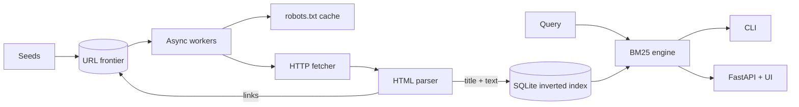

# PySearch

An async web crawler and full-text search engine written from scratch in Python.
It crawls sites politely, builds an inverted index in SQLite, and ranks results with
**Okapi BM25**. Search from the CLI, a JSON API, or a small web UI.

## Features

- **Async crawler** (`asyncio` + `aiohttp`) with a worker pool and breadth-first frontier
- **Polite by default**: `robots.txt` (Disallow and Crawl-delay), per-host rate limiting,
  response size cap, timeouts, retries with backoff
- **SSRF protection**: refuses localhost, private, link-local (cloud metadata) and other
  non-public addresses and blocks DNS rebinding
- **Policy-checked redirects**: every redirect target is validated (public address, same-site
  rule, robots.txt) *before* it is requested
- **Size limits**: oversized responses are detected and skipped, never indexed half-read
- **Search-quality evaluation**: `pysearch eval` reports Precision@k, Recall@k, MRR and NDCG@k
- **URL normalisation and dedup**: fragments, default ports, asset extensions, `rel=nofollow`,
  `<meta name="robots">`, `<base href>`
- **Inverted index** in SQLite (WAL mode) with exact-duplicate content detection and re-indexing
- **BM25 ranking** with title boosting, a light stemmer, stopwords and a full-match bonus
- **Snippets** built with the same stemming as the index, with highlighted matches
- **FastAPI** JSON API and a minimal search UI
- Fully tested without network access (the crawler takes an injectable `Fetcher`)

## Architecture



## Quick start

```bash
python -m venv .venv && source .venv/bin/activate
pip install -e ".[dev]"

pysearch crawl https://docs.python.org/3/tutorial/ --max-pages 50 --max-depth 2
pysearch search "list comprehension"
pysearch serve            # http://127.0.0.1:8000
```

Only crawl sites you have permission to crawl, and set a real contact URL in
`CrawlConfig.user_agent`.

## API

| Endpoint | Description |
| --- | --- |
| `GET /search?q=...&limit=10&offset=0` | Ranked results with snippets |
| `GET /stats` | Documents, distinct terms, average length |
| `GET /health` | Liveness check |
| `GET /docs` | Interactive OpenAPI docs |

## Security

The crawler fetches arbitrary URLs, so it treats them as untrusted:

- Only public addresses are fetched. Loopback, RFC 1918, link-local (`169.254.169.254`),
  CGNAT, multicast, IPv4-mapped IPv6, `localhost`/`.local`/`.internal` names and numeric IP
  tricks (`2130706433`, `0x7f.0.0.1`) are rejected.
- Redirects are followed manually (max 5). The crawler passes the fetcher a validator that is
  called for every hop *before* the request is sent: it checks the address, the same-site rule
  and the target's robots.txt, and a veto means the target is never contacted.
- A custom DNS resolver drops non-public answers, so a hostname cannot rebind to an internal
  IP after the check. System proxies are ignored (`trust_env=False`) so they cannot bypass it.
- `--allow-private` turns the guard off for crawling a local dev server. Never use it on a
  server that accepts crawl requests from other people.

## robots.txt handling (RFC 9309)

| robots.txt response | Behaviour |
| --- | --- |
| 200 | Rules are parsed and obeyed (cached 24 h) |
| 4xx (missing) | Everything allowed |
| 5xx, 429, network failure | Treated as disallow-all, re-checked after 5 minutes |

## Measuring search quality

Passing unit tests says nothing about relevance. To measure it, write a judgments file of real
queries and the URLs that should answer them (see `examples/judgments.example.json`; graded
relevance `{url: grade}` or a plain URL list), crawl your corpus, then:

```bash
pysearch eval my_judgments.json --k 10 --per-query
# queries=120  P@10=0.412  R@10=0.780  MRR=0.655  NDCG@10=0.701  latency=1.8 ms
```

Re-run it after every ranking change (new stemmer, field weights, hybrid search) so each
improvement is backed by numbers. A useful set has 100+ queries labelled by a person.

## Docker

```bash
docker build -t pysearch .
docker run -p 8000:8000 -v pysearch-data:/data pysearch
```

## How ranking works

For each query term, BM25 scores a document as

`idf(t) * tf * (k1 + 1) / (tf + k1 * (1 - b + b * len / avg_len))`

with `k1 = 1.5`, `b = 0.75`. Title words count three times towards term frequency, and
documents containing every query term get a 1.25x bonus.

## Project layout

```
src/pysearch/
  crawler.py    workers, frontier, politeness, retries, depth and page limits
  fetcher.py    HTTP fetching with manual redirects and a public-only DNS resolver
  security.py   SSRF checks for hosts and URLs
  robots.py     robots.txt cache with RFC 9309 failure handling
  parser.py     HTML -> title, text, links, robots directives
  urls.py       URL normalisation
  tokenizer.py  tokenising, stopwords, stemming
  index.py      SQLite inverted index
  evaluation.py Precision@k, Recall@k, MRR, NDCG@k
  search.py     BM25 ranking and snippets
  api.py        FastAPI app and UI
  cli.py        pysearch crawl | search | stats | serve
tests/          unit, crawler, and local-server HTTP tests
examples/       sample judgments file for `pysearch eval`
```

## Testing

```bash
pytest -q
```

## Changelog

**0.2.0** (fixes from a code review, each with regression tests)

- Security: SSRF guard, per-hop redirect validation, DNS-rebinding protection
- Fix: re-indexing a URL whose new content duplicated another page (or was empty) left the old
  version searchable; replacement is now one transaction. Noindex pages and 404/410 responses
  now remove previously indexed copies
- Fix: robots.txt 5xx / 429 / network errors no longer mean "allow everything"
- Fix: invalid config (for example `concurrency=0`, which hung forever) now raises `ValueError`
- Fix: snippets now match by stem and highlight matches (safe DOM rendering in the UI)
- Added: retries with exponential backoff, same-site matching that ignores `www.`

**0.2.1** (second review)

- Fix: redirect policy (same-site, robots.txt) was enforced after the redirect target had
  already been requested; it is now checked before every hop via a validator callback
- Fix: responses over `max_bytes` were silently truncated and indexed; they are now flagged
  (`too_large`) and skipped. Bodies are read chunk by chunk, because `StreamReader.read(n)`
  can return fewer than n bytes
- Fix: a `Crawler` instance can be reused (fresh stats, frontier and robots cache per run);
  overlapping runs on one instance raise `RuntimeError`
- Fix: text beyond 100,000 characters is no longer indexed, so document length, postings and
  stored text always describe the same content
- Added: `pysearch eval`, HTTP-level tests against local servers (redirects, caching, robots
  failures, size caps), and `examples/judgments.example.json`

## Roadmap

- Hybrid BM25 + embedding retrieval and reranking
- PageRank-style link scoring
- Field-weighted ranking (h1/h2, meta description, URL)
- Phrase queries using term positions
- Sitemap.xml discovery
- Distributed crawling with a Redis-backed frontier
- Incremental recrawls using ETag / Last-Modified
- Query suggestions and highlighting

## License

MIT
